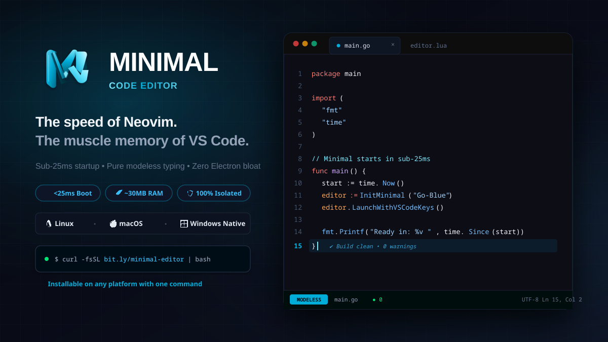

# Minimal Code Editor

<p align="center">
  
</p>

> **The Fluent, Modeless Code Editor for Linux**  
> *Crafted by indiedev*  
> Blends the blazing speed, low resource usage, and keyboard ergonomics of the terminal with the modeless simplicity, authentic aesthetics, and visual power of modern IDEs.

---

## ⚡ Core Highlights & Guarantees

1. **Modeless Editing**: Start typing immediately without mode friction. Text buffers operate in permanent insert mode like VS Code or Zed, while sidebars, menus, and pickers respond instantly to intuitive keys.
2. **Minimal Homescreen**: A bold ASCII dashboard on startup featuring quick keyboard shortcuts (New File, Open Folder, Themes, Fonts, Shortcuts, Terminal) and recent file jump.
3. **Authentic File & Folder Icons**: Vivid logo colors across tabs and sidebar explorer (Python `#ffd43b`, Markdown `#519aba`, Shell `#4ebd54`, Configs `#e5c07b`, golden folders), with live color persistence across theme changes.
4. **Code Spell Checker & Dictionary**: Integrated spell engine with camelCase support, quick suggestion popup, and one-click user dictionary expansion (`Ctrl+.`).
5. **Interactive Menus**:
   - **Color Themes** (`Ctrl+K Ctrl+T`): Handcrafted palettes (*Dark Magic*, *Cyber Aurora*, *Medieval*, *Nocturne*) with live preview.
   - **Font & Appearance** (`Ctrl+Shift+K+T`): Interactive GUI font family, font size, line-spacing, and boldness settings.
   - **Keyboard Shortcuts** (`Ctrl+P` / `Ctrl+Shift+P`): Clean, searchable cheatsheet with breathable sections.
6. **Integrated Terminal Drawer**: Sliding bottom terminal (`Ctrl+``) with git branch prompt and automatic file opening delegation to the parent editor.
7. **Multi-Cursor & Line Manipulation**: VS Code-compatible multi-selection (`Ctrl+D`), line moving (`Alt+Up/Down`), line duplicating (`Alt+Shift+Up/Down`), and block comments (`Shift+Alt+A`).
8. **Linux-Native GUI & Terminal Dual Mode**: Launch in pure terminal mode in any terminal emulator, or launch with frosted glass transparency and smooth animations via Neovide (`minimal --gui`).

---

## 🚀 One-Line Installation (Linux OS)

Minimal is packaged and optimized specifically for Linux distributions (Ubuntu, Debian, Arch Linux, Manjaro, Fedora, openSUSE, Alpine, Void).

Run this one-liner in your terminal:

```bash
curl -fsSL https://raw.githubusercontent.com/utkarshIsAProgrammer/minimal/main/install.sh | bash
```

*(Or using `wget`: `wget -qO- https://raw.githubusercontent.com/utkarshIsAProgrammer/minimal/main/install.sh | bash`)*

### Installing from Cloned Repository

```bash
git clone https://github.com/utkarshIsAProgrammer/minimal.git
cd minimal
chmod +x install.sh
./install.sh
```

---

## 💻 Usage

```bash
# Launch Minimal Homescreen
minimal

# Open current directory as workspace
minimal .

# Open or create a file anywhere
minimal src/main.py

# Launch in Neovide GUI mode (frosted glass & smooth animations)
minimal --gui

# Display help and version
minimal --help
minimal --version
```

---

## ⌨️ Essential Keyboard Shortcuts

| Shortcut | Action |
| :--- | :--- |
| **Ctrl+S** | Save current file (auto-creates parent directories) |
| **Ctrl+N** | New file |
| **Ctrl+P** / **Ctrl+Shift+P** | Command Palette & Keybindings cheatsheet |
| **Ctrl+B** | Toggle sidebar file explorer |
| **Ctrl+\`** | Toggle bottom integrated terminal drawer |
| **Ctrl+K Ctrl+T** | Open live Color Themes picker |
| **Ctrl+Shift+K+T** | Open Font & Appearance settings |
| **Alt+Up** / **Alt+Down** | Move selected / current line up or down |
| **Alt+Shift+Up** / **Down** | Duplicate current line up or down |
| **Ctrl+D** | Multi-cursor (select next occurrence of word) |
| **Shift+Alt+A** | Toggle multi-line block comment |
| **Ctrl+.** | Spell check suggestions & Add to user dictionary |
| **Shift+Delete** | Delete entire current line |
| **Ctrl+Backspace** | Delete previous word |
| **Ctrl+Delete** | Delete next word |
| **Ctrl+Left** / **Right** | Navigate word by word |
| **Ctrl+W** | Close current tab |

---

## 🧹 Clean Uninstallation

If you ever wish to remove Minimal, run:

```bash
./uninstall.sh
```

Or non-interactively:

```bash
./uninstall.sh --yes
```

This safely purges all configurations, application links, desktop entries, and plugin caches, leaving your host system completely clean.

---

## 📄 License

MIT License. Designed and crafted with care by **indiedev** ([utkarshIsAProgrammer](https://github.com/utkarshIsAProgrammer)).
